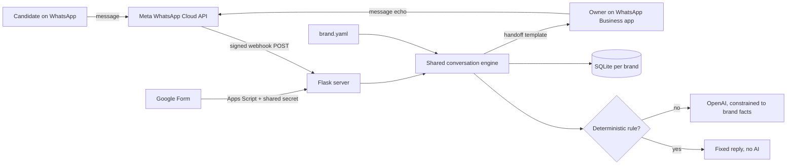

# WhatsApp Recruiting Engine

An automated WhatsApp assistant that answers sales-consultant candidates for direct-sales jewelry brands, collects their registration, and hands the conversation to a human at any moment, from the same business number.

Built and piloted for a Brazilian semi-fine jewelry brand. Designed from day one to be replicated to other brands **without changing code**.

> **Source code:** this repository is a public showcase of the architecture, security decisions and test strategy. The engine itself is a commercial product and stays private. Code review access is available on request.

---

## The problem

A brand recruiting sales consultants received hundreds of WhatsApp messages and answered each one by hand: same questions, same registration link, same follow-ups. Good candidates waited hours for a reply.

## What the engine does

| Step | Behavior |
| --- | --- |
| First contact | Greets the candidate, asks her name, explains how the program works using **only facts the brand confirmed in writing** |
| Questions | Clear, repeated questions are answered by deterministic rules (zero AI cost). Anything else goes to the AI, constrained to the brand's confirmed facts |
| Registration | Sends the official Google Form, then links the submitted form back to the WhatsApp contact |
| Human handoff | When the candidate asks for a person, the AI fails, or the AI budget is reached, the owner is notified with a WhatsApp template |
| Human takeover | When the owner replies from the WhatsApp Business app on the same number, the bot detects it and **never re-enters that conversation** |
| Opt-out | A candidate who says she is not interested is never contacted again by the bot |

The AI **never approves or rejects a candidate**. Every decision about people stays human.

## Architecture at a glance

More detail in [docs/ARCHITECTURE.md](docs/ARCHITECTURE.md).

## Security by design

| Decision | Principle | Risk removed |
| --- | --- | --- |
| One generic engine; each brand is only a YAML file | Separation of code and configuration | Brand-specific logic leaking into shared code |
| Secrets only in `.env`, never in code, YAML or Git | Secrets management | Credentials exposed in a repository |
| One isolated instance and database per brand | Tenant isolation, least privilege | One brand reading another brand's candidates |
| Every WhatsApp POST verified with HMAC-SHA256 (`X-Hub-Signature-256`) | Message authenticity | Forged webhooks injecting fake conversations |
| Constant-time comparison for all tokens | Side-channel resistance | Token guessing through timing |
| Deterministic rules first, AI only when needed | Attack-surface reduction | Prompt injection and unpredictable output on routine paths |
| AI limited to facts in the brand YAML | Output validation | The AI inventing commissions or promises |
| Timeouts on every external call, safe fallback to a human | Fail-safe design | Silent non-response when OpenAI or Meta is down |
| Duplicate webhook IDs ignored | Idempotency | Double replies when Meta re-delivers a message |
| Per-contact AI call budget | Abuse and cost control | One contact draining the API budget |
| Personal data never logged; LGPD rules documented | Privacy by design | Leaking CPF, address or income through logs |

Full threat model: [docs/SECURITY.md](docs/SECURITY.md).

## Testing

**1,272 automated offline tests, all passing**, plus 49 scenario checks against the real OpenAI API.

| Suite | Tests | What it proves |
| --- | ---: | --- |
| Quick replies | 536 | Deterministic answers and fixed messages |
| WhatsApp webhook | 164 | Signature check, parsing, deduplication, sending |
| Form fields | 127 | Google Form mapping and data normalization |
| Human takeover | 124 | Owner takeover detection; bot never returns |
| Engine logic | 113 | State machine, handoff, follow-up rules |
| Form intake | 95 | Form-to-contact matching without guessing |
| Replicability | 51 | A new brand works with a YAML file only |
| Human notification | 62 | Owner alert templates, unit + integration |

Details: [docs/TESTING.md](docs/TESTING.md).

## Stack

Python 3 · Flask · SQLite · WhatsApp Cloud API · OpenAI API · Google Forms + Apps Script · YAML configuration

## What I learned

The hardest part was not the code. It was deciding what the program must **never** do: never approve a person, never invent a number, never talk over a human. Writing those rules first and testing against them is how I approach every system now.

---

**Guilherme Goedert** · Business Analytics + Cybersecurity, Grand View University
