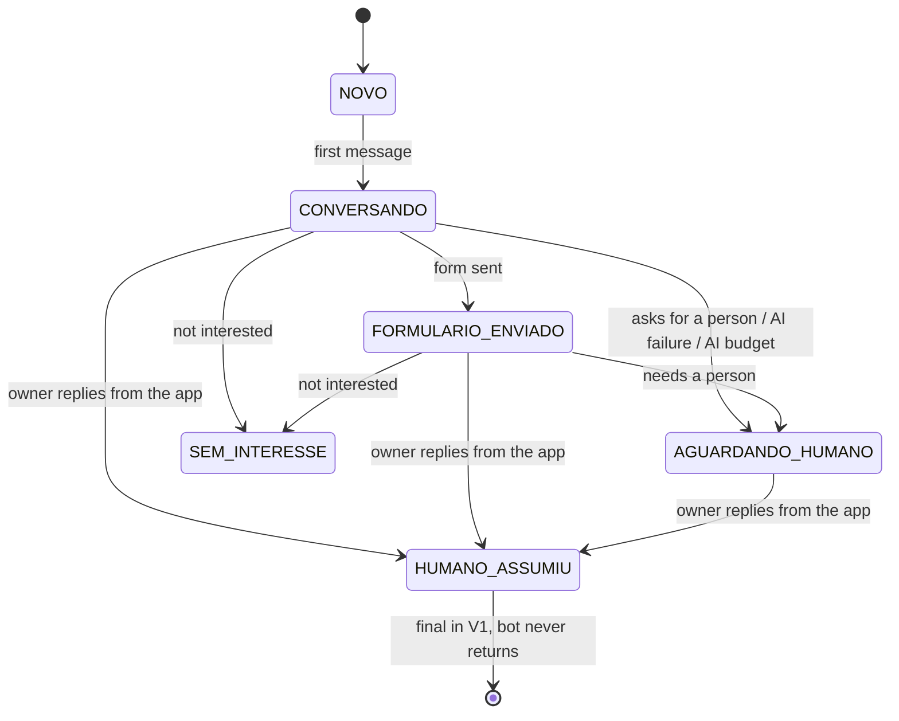

# Architecture

## Components

| Component | Responsibility |
| --- | --- |
| `server` | Flask app with three endpoints: WhatsApp webhook verification (GET), WhatsApp messages (POST), Google Form intake (POST) |
| `conversation` | State machine for each contact: decides between fixed reply, AI reply, form, handoff or silence |
| `intent` | Deterministic detection of clear intents (wants the form, wants a person, not interested, already filled the form) |
| `faq` | Exact-match FAQ answers from the brand YAML, zero AI |
| `ai` | OpenAI client with timeout; the system prompt is rendered from the brand's confirmed facts |
| `whatsapp` | Payload parsing, HMAC signature check, message sending, owner echo parsing |
| `form_intake` | Stores Google Form submissions and links them to a contact by normalized phone, never by guessing |
| `notification` | Sends the approved WhatsApp template to the owner when a person is needed |
| `database` | SQLite schema and migrations, one database per brand |
| `config` | Loads and validates the brand YAML; the server refuses to start on an invalid file |

## Conversation states

`HUMANO_ASSUMIU` can only be set by one code path: a verified message echo from the owner's WhatsApp Business app. Messages the bot itself sent are tracked, so they never trigger a false takeover.

## Replicating to a new brand

1. Copy `config/company.example.yaml` to `config/<brand>.yaml` and fill in only what the brand confirmed in writing.
2. Create a `.env` for that instance with `COMPANY=<brand>` and its own keys.
3. Start a separate instance. Code and prompt stay identical for every brand.

The replicability test suite fails if any brand-specific value appears in shared code.
